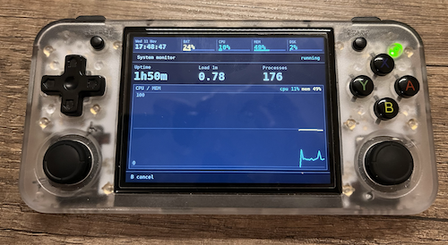
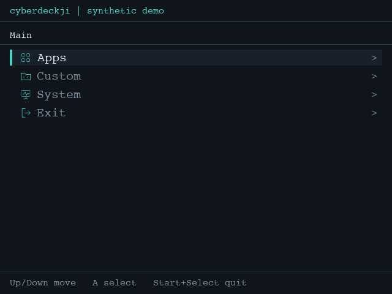
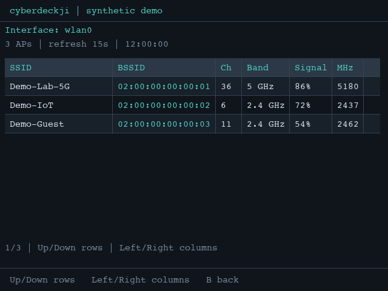
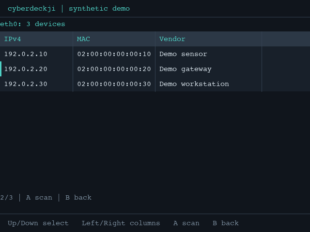
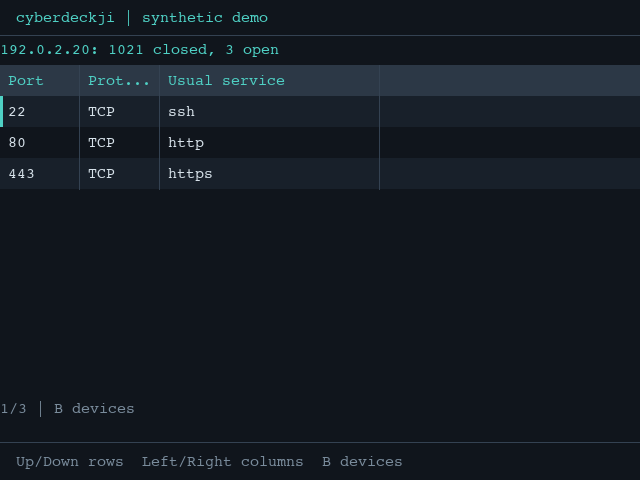

# cyberdeckji

A small framework for button-only Linux handhelds: write an app in a few
lines, get progress bars, graphs and logs for free.

    pip install -r requirements.txt
    python3 deck.py              # fullscreen
    python3 deck.py --windowed   # for testing on a desktop

Console without X11? Try `SDL_VIDEODRIVER=kmsdrm python3 deck.py`.

## Requirements and permissions

| Component | Required for |
|---|---|
| Python 3, `pygame-ce` (imported as `pygame`), `psutil` | Launcher and native Python apps; install with `python3 -m pip install -r requirements.txt` |
| `arp-scan` and `nmap` | LAN device discovery and TCP port scanner |
| NetworkManager with `nmcli` | Wi-Fi scanner; NetworkManager must be running |
| `mkfs.fat`, `mkfs.ext4`, `mkfs.ntfs`, `parted`, `partprobe` | Removable-storage formatting (only the selected filesystem formatter is required; partition tools are needed for whole drives) |
| `systemctl`, GNU `timeout`, installed USB gadget services | USB-OTG apps |
| `fallocate`, `parted`, and the selected `mkfs` formatter | Creating USB-OTG storage images (`mkfs.exfat` is needed for exFAT) |

For Debian/Ubuntu-based devices, install the network tools with:

```bash
sudo apt update
sudo apt install arp-scan nmap network-manager
```

For the removable-storage tools on Debian/Ubuntu, install the relevant tools:

```bash
sudo apt install dosfstools e2fsprogs ntfs-3g parted util-linux f3
```

For exFAT image creation, also install `exfatprogs`.

**The GUI does not generally require root.** ARP discovery requires raw-packet
access, normally provided by root or administrator-configured executable
capabilities. The Nmap app uses TCP connect scanning (`-sT`), which does not
itself require root. Wi-Fi scanning depends on NetworkManager's permissions.

If your system requires root for `arp-scan`, running the launcher as root also
runs every native app and custom script with root privileges. Only do this with
reviewed, trusted code; prefer administrator-configured permissions for the
specific tool rather than elevating the entire GUI. The launcher never invokes
sudo automatically.

## USB-OTG (Linux)

**Apps > USB-OTG** contains:

- **USB-MTP** starts the installed `usb-mtp` service.
- **USB Storage** selects an existing `.img` from `~/Images/` or
  creates a 1, 4, 8, 16 or 32 GiB image there, named `SIZE-YYYYMMDD-index.img`
  (for example `4G-20261112-0.img`). The index starts at 0 and skips existing
  names without overwriting them. New images
  contain one MBR partition formatted as FAT32, exFAT, ext4 or NTFS. Space is
  allocated upfront; failed or cancelled creation removes partial files.
  Reopen the form to refresh its image list.
- **USB CD-ROM emulator** selects a `.iso` from `~/ISO/`. Add ISO
  files separately, then reopen the form to refresh its choices.

These folders are outside the project directory. When launched with `sudo`,
the apps use the invoking user's home and give that user ownership of newly
created storage images. Move existing files from `~/cyberdeckji/Images/` and
`~/cyberdeckji/ISO/` into `~/Images/` and `~/ISO/` respectively.
Backups use `~/Backups/` beside these folders, including when launched with
`sudo`; backup and restore tools share that location.

The storage apps update `/etc/default/usb-massstorage` and start the installed
`usb-massstorage` service. They set `USB_MASS_STORAGE_MODE` and
`USB_MASS_STORAGE_IMAGE`; disk mode also sets `USB_MASS_STORAGE_SIZE` to the
chosen size (such as `1G`) for new images or the exact byte size for existing
ones. Other settings are preserved. **The service is
external to this project:** verify that its installed implementation accepts
these settings and byte sizes, and does not recreate or overwrite existing
images, before using it. Host compatibility depends on the selected filesystem.

Press B to stop the service. The launcher needs permission to edit the
configuration and control the services; it never elevates privileges.
Image creation needs sufficient free space and the tools listed above; it does
not require a loop device. Its tool search includes `/usr/sbin` and `/sbin` even
when the launcher's `PATH` omits them. If the requested service is already active, the app
leaves it untouched. Cleanup cannot be guaranteed after a crash or forced
termination. Avoid starting or stopping these services concurrently elsewhere.
Service commands disable paging. For manual diagnostics without an interactive
pager, use `sudo systemctl --no-pager status usb-massstorage.service`.

## Screenshots

### Running on real hardware

cyberdeckji's System monitor running on an **Anbernic RG35XXH**:



### Interface previews

Captured from the actual pygame views at 640x480 using synthetic demo data.
These illustrate the interface, not results from a real network scan.

| Launcher | Wi-Fi discovery |
|---|---|
|  |  |

| Select a LAN device | TCP port results |
|---|---|
|  |  |

## Responsible use

The included discovery tools are for diagnostics on networks you own or have
explicit permission to inspect. ARP discovery and TCP scans generate network
traffic; Wi-Fi discovery can transmit probes. Do not use them for unauthorized
access, disruption or unlawful attacks. No exploit, credential attack or
automatic privilege elevation is included.

See [SECURITY.md](SECURITY.md) for security reports and abuse concerns.
GitHub [permits dual-use security research tools](https://docs.github.com/en/site-policy/acceptable-use-policies/github-active-malware-or-exploits),
but prohibits using its platform to support unlawful attacks. Hosting permission
does not replace authorization or compliance with applicable laws.

## License and attribution

cyberdeckji is licensed under [Apache-2.0](LICENSE). Preserve the license,
applicable copyright/attribution notices and [NOTICE](NOTICE) when redistributing;
mark modified files as required by the license. Visible credit to cyberdeckji
is appreciated but is not an additional license condition.

Dependencies and external commands retain their own licenses. This repository
does not bundle `nmap`, `arp-scan` or NetworkManager; install them separately.
Review their licenses before distributing a combined software image.

## Removable storage (Linux)

**Apps > Removable Storage > Disk information** shows the size of a selected
USB drive or SD card and a scrollable table of its partitions, sizes and
filesystem types. Mounted and read-only media can be inspected. It uses
`lsblk` from util-linux without changing the drive; unavailable filesystem
information is shown as **Unknown**, and Linux `vfat` is shown as **FAT**
(without distinguishing FAT versions). Drive health/SMART is not assessed.

**Apps > Removable Storage > Format drive** formats an existing partition or
an entire USB storage device or SD card as FAT32, ext4 or NTFS. Whole-drive
formatting destroys the partition table and all partitions, then creates a new
MBR or GPT table with one partition. MBR is the default; drives larger than
the app's conservative 2 TiB MBR limit require GPT. The operation permanently
destroys data; it is not a secure data-erasure tool.

Select the device, filesystem, and (for whole drives) partition table. Confirm
the device name and capacity, explicitly set **Erase data?** to Yes, then
select **Format**. Changing the selection resets the confirmation. The
progress bar is indeterminate when the formatting tools cannot report reliable
overall progress. An interruption or error can leave the drive partially
formatted; do not remove it while the operation is running.

Only positively identified USB storage and SD cards are offered. The app
excludes the disk backing the running root filesystem, along with disks with
mounted partitions, active swap, or block-device holders. If the root backing
disk cannot be identified, formatting is unavailable rather than guessing;
this can happen with overlay or other virtual root filesystems. The app follows
block-device dependencies for supported layered roots. It does not attempt to
identify detached or unmounted boot media separate from the running root disk.
For other removable media,
unmount or release all partitions on the disk first. It rechecks identity and
usage before destructive steps, but hotplug and mount races cannot be entirely
eliminated. It refuses to run when it cannot check process mount information,
system metadata or device permissions. Tools and permissions must already be
available; the app never automatically invokes sudo or unmounts media. If
elevating the launcher is necessary, remember that all native and custom code
runs with those privileges. Formatter/partitioner errors are displayed.
If no eligible drives are available, the setup shows an empty state; connect or
unmount a drive, then press B and reopen the formatter to refresh the list.

The other Removable Storage tools share the formatter's drive discovery and
safety checks: the system disk and mounted or busy drives are never listed,
and an empty state is shown when nothing is eligible. Destructive tools need an
explicit **Yes** confirmation, which resets whenever another field changes.
Most need read/write access to `/dev/sdX` or `/dev/mmcblkN` (usually root).

- **Backup drive** saves a whole drive to
  `~/Backups/<Drive>-<YYYYMMDD-HHMMSS>.img` (raw; can be loop-mounted or used
  with Ventoy) or `.img.gz` (gzip level 1; smaller but slower). A `.json`
  sidecar records the original size. Raw backups check free space first;
  failed or cancelled backups delete the partial file.
- **Backup files** mounts a selected partition read-only and lets you select
  files and folders from different directories. It copies only selected content
  into `~/Backups/<Drive>-<YYYYMMDD-HHMMSS>/`, retaining partition-relative paths,
  rather than creating a drive image. See the controls and limitations below.
- **Restore drive** writes a `.img`/`.img.gz` from `~/Backups` over a whole
  drive. It refuses drives smaller than the image and stops if an image of
  unknown size overflows the drive.
- **Filesystem check** runs `fsck.fat`, `e2fsck` or `ntfsfix` on an unmounted
  partition, either **Check only** (no changes) or **Check and repair**.
  `ntfsfix` only fixes basic NTFS problems.
- **Secure wipe** offers **Quick** (`wipefs` plus zeroing the first and last
  MiB), **Scramble** (Quick plus random data over the first/last 64 MiB and one
  random MiB in every 64 MiB, about 2%) and **Full zero** (every byte). Scramble
  defeats normal recovery, but file carving may recover fragments. Because of
  flash wear leveling, no software wipe can be guaranteed.
- **Speed test** reads up to 256 MiB from the raw drive, then temporarily
  mounts its first FAT/exFAT/ext/NTFS partition, writes a file of up to
  256 MiB (leaving 16 MiB free), deletes it, and always unmounts. The write test
  is skipped when the partition has less than 32 MiB free or there is no
  mountable partition. Results are shown as graphs, and USB 2.0 limits speed.
- **Fake capacity check** runs `f3probe --min-memory --time-ops`, trading speed
  for lower RAM usage, in its default non-destructive mode, which restores every
  block it writes, to detect
  counterfeit drives. Cancelling or unplugging during the probe can leave
  blocks unrestored.

### Backup files

Open **Apps > Removable Storage > Backup files**. Choose **Drive**, then
**Partition**, then **Browse**. The drive must have all partitions unmounted;
the system disk, swap and busy devices are excluded. Partition choices follow
the selected drive. Connect/unmount a drive and reopen setup to refresh.

Use **Up/Down** to move, **A** to open a folder, and **X** (or **Right**, including
the keyboard Right arrow) to select/deselect a file or folder. A on a file also
toggles it. A selected folder includes its entire contents, including hidden
files and empty folders. Selections persist as you navigate; overlapping
selections are copied only once. **B** goes up; at the partition root it closes
the browser and triggers cleanup. Highlight **Back up selected** and press A to
start. Scanning is indeterminate; copying shows the current file, copied/total
bytes and progress. B cancels during scanning/copying.

Output is ordinary files, not an archive, with paths relative to the partition:
selecting `Documents/notes.txt` creates
`~/Backups/<Drive>-<Date>/Documents/notes.txt`. Existing backups are not
overwritten; collisions get a numeric suffix. Failed/cancelled copies stay
marked `.partial`, with their path shown; there is no automatic resume or merge.
The backup uses the home directory of the user running the launcher.

This tool needs Linux `mount`, `umount`, `blkid` (util-linux), `timeout`
(coreutils), and permission to mount the device (normally root). It mounts
FAT/exFAT/ext2/ext3/ext4/NTFS read-only with execution/device/setuid restrictions;
ext3/ext4 disable journal replay and NTFS uses the kernel `ntfs3` driver's
`norecover` option. Unsupported/missing drivers, dirty filesystems needing
recovery and mount failures are reported without a read-write fallback.
No repair is attempted.

Source symlinks are preserved as links, never followed; they can still point
outside the backup when opened later. Nested mounts and special files (devices,
sockets, FIFOs) are refused. File/directory timestamps and ordinary permission
bits are preserved where supported; metadata failures are reported. This is
not a full-fidelity clone: ownership, ACLs/xattrs, hard-link relationships,
setuid/setgid bits and sparse allocation are not preserved.

The shutdown hook unmounts only the tool's own mount after success, browser exit,
cancellation or error. Wait for **Source unmounted** before removing the drive.
Unmount failures keep the mount directory and show its path; manually resolve
the failure before removing media. Never unplug during a copy or cleanup.

## Port scanner (Linux)

Open **Apps > Network > Port scanner** to inspect your own local IPv4 network.
Choose an active Ethernet/Wi-Fi interface and TCP range: **1–1024** (default),
**1–10000**, or **1–65535**. Port zero is excluded.

Install `arp-scan` and `nmap` through your Linux distribution. ARP discovery
requires raw-packet permissions configured by your administrator; the app does
not run sudo or elevate privileges automatically. Missing tools, permission
failures and invalid results are displayed.

Discovery shows a table of **IPv4 / MAC / vendor**. Use Up/Down to highlight a
device and **A** to scan it; Left/Right scrolls columns. Nmap performs a TCP
connect scan of only that discovered local device, without DNS, version/OS
probes or scripts. Results list **open port / protocol / usual service** (e.g.
22 / TCP / ssh), with closed/filtered totals above the table. Service names are
conventional port labels, not confirmation of the software actually running.
**B** from results returns to devices; during a scan it cancels the command.
From the device list B cancels, then B returns to setup.

Only scan networks you own or have permission to inspect. ARP cannot discover
routed or IPv6-only devices; sleeping IoT devices and Wi-Fi client isolation may
hide hosts. Full TCP scans can take longer and generate substantial traffic.
Results are not automatically refreshed. No network settings are changed.

## Wi-Fi scanner (Linux)

Open **Apps > Network > Wi-Fi scanner** to list nearby access points with their
SSID, full BSSID, channel, frequency, **2.4/5 GHz band**, and signal percentage.
Select a detected wireless interface with Left/Right (`All available` uses
available adapters), band
filter and refresh interval, then select **Scan Wi-Fi**. The detected interfaces
are displayed above a table with SSID, BSSID, channel, band, signal and frequency
columns. Up/Down scrolls rows; Left/Right scrolls columns on narrow screens.
B cancels an active scan or the wait for refresh.

This app requires Linux, **NetworkManager running with `nmcli` installed**, a
managed Wi-Fi adapter, enabled/unblocked Wi-Fi and permission to scan. Use your
distribution's NetworkManager package; there is no additional Python dependency.
It performs ordinary discovery without monitor mode and never connects,
disconnects or changes radio state. Scans can transmit discovery probes and are
not passive packet capture.

Both bands are requested by default, but visibility depends on the adapter,
driver and regulatory settings; a 2.4-only adapter cannot discover 5 GHz.
6 GHz results are excluded, with bands determined from frequency rather than
overlapping channel numbers. Hidden SSIDs stay marked hidden; distinct BSSIDs
sharing an SSID remain separate entries.

Interface choices are detected from Linux sysfs whenever setup is opened;
missing adapters or detection failures are reported. NetworkManager availability
and adapter state are checked again when scanning.

The interval is a 5..120 second wait **after** each completed scan (default 15),
not a guaranteed sweep rate; NetworkManager/drivers may throttle scan requests.
Successful refreshes replace the current list rather than appending history.
An error stops refresh and shows its diagnostic; previous results are explicitly
marked **STALE**. Press B to return to setup and run again. On a non-Linux
desktop the entry is visible but explains that Linux is required.

## Documentation

| Guide | Purpose |
|---|---|
| [AGENTS.md](AGENTS.md) | Agent entry point and reading map |
| [INSTRUCTIONS.md](INSTRUCTIONS.md) | Contributor workflow and compatibility rules |
| [Architecture](docs/ARCHITECTURE.md) | Module map, discovery, navigation, input and execution lifecycle |
| [Custom scripts](docs/CUSTOM_SCRIPTS.md) | Complete Python/Bash recipes, parameters, icons and explicit menu trees |
| [Testing](docs/TESTING.md) | Test commands, coverage map, manual checks and troubleshooting |

This README is the public usage/API overview. Start with the custom-script
guide to add a user tool, or the agent instructions to modify the framework.

## Write an app (Python)

Drop a file in `apps/`. It appears in the launcher on next start.

```python
from deckfw import app, Graph

@app(name="Port check", group="Network")
def port_check(ctx):
    graph = ctx.add(Graph(title="latency", unit=" ms"))
    for i in range(20):
        graph.push(12 + i % 5)
        ctx.progress((i + 1) / 20, f"probe {i + 1}/20")
        ctx.log(f"probe {i + 1} ok")
        ctx.sleep(0.5)              # wakes instantly if the user presses B
```

Your function runs in its own thread, so blocking is fine. Pressing B cancels:
the next `ctx.sleep()`, `ctx.run()` or `ctx.check()` raises `Cancelled` and
unwinds your function (use `try/finally` for cleanup). B again closes the screen;
it cannot forcibly terminate a Python thread, so cancellation must be cooperative.

### ctx API

| Call | What it does |
|---|---|
| `ctx.add(widget, flex=None, index=None)` | Put a widget on screen (`index=0` = top) |
| `ctx.row(w1, w2, ...)` | Place widgets side by side |
| `ctx.progress(0.4, "label")` | Progress bar, 0..1 (`None` = indeterminate) |
| `ctx.log("text", color="warn")` | Append to the scrolling log |
| `ctx.run([cmd, ...], on_line=fn)` | Run a command, stream output to the log, return `(returncode, lines)` |
| `ctx.sleep(s)` / `ctx.check()` | Cancellable wait / cancellation check |
| `for _ in ctx.loop(1.0):` | Repeat every second until cancelled |
| `ctx.note = "text"` | Text in the header |
| `ctx.params["key"]` | Validated values from the optional pre-launch setup form |

`ctx.run` takes a **list**, never a shell string. `log=False` hides output,
`log=some_logview` redirects it, `protocol=True` enables `@directives`.

### Widgets

`Label`, `Stat` (big number tile), `ProgressBar`, `Graph` (multi-series,
auto-scaling), `LogView`, `ListView`, plus `VBox` / `HBox` for layout.
Change their attributes from your thread (`bar.value = 0.5`, `graph.push(3)`);
never draw them yourself. Colors: `"ok" "warn" "crit" "accent" "dim" "text"`
or an `(r, g, b)` tuple.

## Add a standalone script

Put a `.sh`, `.bash`, `.py`, or other executable file in **`custom/`**.
Restart the deck and find it at the **Custom** menu root. No decorator, menu
edit, header, or executable permission is needed for Bash/Python files.
For example, `custom/my_scan.py` appears as **My Scan**. Files starting with
`.` or `_` and subdirectories are ignored.

An optional `# deck:` header in the first 20 lines overrides the display name.
Custom script group headers do not create submenus: only explicit placement in
`menu.py` does. This example appears as **Custom > My scan**:

```sh
#!/bin/sh
# deck: My scan
echo "@progress 40 Scanning"     # progress bar, 0-100 ("?" = indeterminate)
echo "@graph latency 12.5"       # value for the graph named "latency"
echo "@stat hosts=12"            # big number tile
echo "@status halfway"           # note in the header
echo "any other line goes to the log"
```

Scripts run only when selected, not during discovery. Their output and errors
appear on screen, nonzero exits show an error, and B cancels the process and
its children. They run with their own folder as the working directory, so
relative paths to data files work. Scripts must not prompt for terminal input.

A shebang such as `#!/bin/bash`, `#!/bin/sh`, or
`#!/usr/bin/env python3` selects the interpreter, even without executable
permission. Without a shebang, `.sh`/`.bash` files use Bash and `.py` files
use the Python running the deck. Other executables run directly.

Both folders accept Python `@app` framework apps, standalone Python scripts
and Bash scripts. The folder determines where they appear: `apps/` is for
native entries under Apps; `custom/` is exclusively for your Custom entries.
Custom `@app` files can use the same widgets and context API as native apps.

## Shutdown hooks and restoration

Framework Python apps can declare `@app(..., shutdown=shutdown)`. The callback
receives the same context and runs once per execution in the worker's `finally`
block: after normal completion, an error, or cooperative cancellation.

```python
from deckfw import app

def shutdown(ctx):
    if getattr(ctx, "previous_mode", None) is not None:
        ctx.log("Restoring previous interface state...")
        # Run your device-specific restoration command with ctx.run([...]).
        # Check returncode and raise an error if restoration fails.

@app(name="Example with cleanup", shutdown=shutdown)
def run(ctx):
    ctx.previous_mode = None  # Save the actual previous state before changing it.
    ctx.log("Running...")
    ctx.sleep(1)
```

During the hook, `ctx.run`, `ctx.check` and `ctx.sleep` are usable despite the
cancel request. Further B presses do not interrupt cleanup. Hook exceptions are
logged and mark the execution as an error. Keep hooks bounded, idempotent and
restore previous state rather than assuming a particular mode.

Standalone scripts can declare `# shutdown: _restore.sh` in their first 20
lines. The path is relative to the main script's folder; it may also reference
a Python script. Prefix cleanup files with `_` so they are not menu entries.
The helper runs after the main process stops, in its own directory with the
same `DECK_PARAM_*` values. Nonzero cleanup exits are reported as errors.
Store any previous state explicitly (for example in an app-specific state file)
because separate processes do not share Python variables or shell variables.

Scripts should still trap SIGTERM/SIGINT themselves for in-process cleanup.
Cancellation now allows **10 seconds** before SIGKILL, and the framework waits
for that process to stop before starting its shutdown helper. Avoid double
restoration by making both mechanisms idempotent.

GUI exit waits up to **15 seconds per app worker** for work and cleanup; a timeout
prints a warning and exits. An uncooperative worker, SIGKILL, power loss or forced
GUI termination can prevent cleanup. Shutdown hooks are not a guarantee against
those events. Ordinary Python `try/finally` remains supported.

## Parameters before execution

Apps can declare a setup function that **returns a form**. The framework handles
input, validation and rendering; your existing `run(ctx)` reads the validated
values from `ctx.params`. Nothing runs until the user selects the final button.

```python
from deckfw import app, Form, Text, Choice, Number, Toggle

def setup():
    return Form([
        Text("host", "IP / Host", default="1.1.1.1", format="host",
             help="A opens the keyboard."),
        Choice("mode", "Mode", choices=[
            ("Quick", "quick"), ("Detailed", "detailed"),
        ], default="quick"),
        Number("count", "Count", default=5, minimum=1, maximum=20, step=1),
        Toggle("verbose", "Verbose", default=False),
    ], submit_label="Start")

@app(name="Parameterized example", setup=setup)
def run(ctx):
    ctx.log(f"Target: {ctx.params['host']}")
    for i in range(ctx.params["count"]):
        if ctx.params["verbose"]:
            ctx.log(f"Step {i + 1} ({ctx.params['mode']})")
        ctx.progress((i + 1) / ctx.params["count"])
        ctx.sleep(0.2)
```

In the setup form, **Up/Down** selects a field or the final action;
**Left/Right** cycles choices, toggles Yes/No or adjusts a number. Numbers stop
at their bounds. **A** opens text editing or activates the final action.
**B** leaves setup without executing anything.

The on-screen keyboard works with the D-pad and A. Select **SHIFT** for uppercase,
**SPACE**, **DEL**, **CUR< / CUR>** for insertion cursor movement, and **OK** to
accept or **CANCEL** to discard. IP-only fields use a numeric/hex-address keypad
(`format="ip"` supports IPv4 and IPv6). Physical keyboards support normal typing,
Left/Right, Home/End, Backspace/Delete, Enter to accept and Escape to discard.
While editing, Q and Space type characters instead of quitting/activating.
The controller Select+Start quit chord and window close still work.

Validation errors stay on screen and block execution. Text supports `required`
(default true), `max_length` (default 256), and `format="text"`, `"ip"` or
`"host"`. Host accepts a single IPv4, IPv6 or ASCII hostname without resolving
it; address ranges/CIDR expressions require general text with your own validator.
Each field can take a pure `validator(value)` returning an error string or
`None`. Defaults are also validated: give required text fields a valid default.
Choice values can be strings, booleans or numbers, independently of their labels.
Numeric fields require finite ordered bounds, a positive step and defaults/bounds
aligned to that step; fractional steps such as `0.1` are supported.

Returning from a completed app takes you back to its setup so you can change
values and run again. Leaving setup and reopening the app resets declared
defaults; selections are not saved. Apps without `setup=` still launch directly.
Choices are fixed in this version, not dependent on another field.

### Standalone Python and Bash parameters

For `custom/example.sh`, add **`custom/example.sh.params.json`** (include the
script's full filename). The same convention applies to `.py` and native scripts
in `apps/`. Sidecars are data only and never become menu entries.

```json
{
  "submit_label": "Run",
  "fields": [
    {"type": "text", "key": "host", "label": "IP / Host",
     "default": "1.1.1.1", "format": "host"},
    {"type": "number", "key": "count", "label": "Count",
     "default": 5, "minimum": 1, "maximum": 20, "step": 1},
    {"type": "toggle", "key": "verbose", "label": "Verbose", "default": false},
    {"type": "choice", "key": "mode", "label": "Mode",
     "choices": [["Quick", "quick"], ["Detailed", "detailed"]], "default": "quick"}
  ]
}
```

Field types are `text`, `choice`, `number`, `toggle`; their options match the Python
constructors except that JSON cannot declare a callable validator. Field keys
must be identifiers and unique even ignoring case. The script receives
**`DECK_PARAM_HOST`**, **`DECK_PARAM_COUNT`**, etc. Strings are passed literally,
booleans are `true`/`false` and numbers use locale-independent decimal notation.
No shell interpolation or process-global environment mutation is performed.

```sh
#!/bin/bash
printf 'Target: %s; count: %s\n' "$DECK_PARAM_HOST" "$DECK_PARAM_COUNT"
```

```python
import os
host = os.environ["DECK_PARAM_HOST"]
count = int(os.environ["DECK_PARAM_COUNT"])
verbose = os.environ["DECK_PARAM_VERBOSE"] == "true"
```

Always quote shell variables and use argument lists in Python subprocess calls;
do not use `eval` or interpolate values into shell commands. A malformed sidecar
shows a load error instead of executing the script. No sidecar means direct
launch. Ordinary scripts must read these variables themselves; hardcoded inputs
are not automatically rewritten.

Try **Custom > Custom Python demo** for all four field types, **Apps > Network >
Ping monitor** for host/probe setup, or **Custom > Network > Network quick check**
for a Bash script with a sidecar. The network check now probes one configured host
for the selected number of rounds instead of cycling through three fixed hosts.

The former `scripts/` folder is now `custom/`: move any existing scripts there
(including standalone tools previously put in `apps/`). Rename any
`scripts_dir` override in `config.json` to `custom_dir`. The `apps_dir` and
`custom_dir` settings override the two folder locations.

## Menu tree

The deck starts on a main menu: **Apps** (grouped by the `group=` you gave
them), **Custom** (only entries discovered in `custom/`), **System**
(System monitor, **Controls** for volume, brightness and
Wi-Fi, plus storage, memory, addresses and uptime) and **Exit** (quit to shell,
reboot, power off; always last). Native entries with `group="System"` go directly
inside System rather than Apps. Custom entries stay under Custom regardless of
their group. System sits immediately before Exit.
B goes back one level, Reboot / Power off ask first and default to No.

Build your own tree in `menu.py` next to `deck.py` (copy `menu.example.py`):

```python
from deckfw import Menu, Submenu, Launch, default_menu, custom_menu

def build(specs):                      # specs = every app/script found
    defaults = {item.label: item for item in default_menu(specs).items}
    scan = next((spec for spec in specs
                 if spec.source == "custom" and spec.name == "Network quick check"), None)

    return Menu("Main", [
        defaults["Apps"],
        Submenu("Custom", custom_menu(specs, [
            Submenu("Network", Menu("Network", [
                Launch(scan),
            ])),
        ] if scan is not None else [])),
        defaults["System"],
        defaults["Exit"],
    ])
```

`custom_menu(specs, items)` keeps your declared tree and appends every custom
script not already placed anywhere in that tree to the Custom root. A placed
script does not also get a root shortcut. Match `spec.name` to its `# deck:`
header, `@app(name=...)`, or generated filename label. Pass concrete `Menu`
instances rather than submenu-producing functions so placements can be found.

The supplied tree places `custom/net_check.sh` at
**Custom > Network > Network quick check**. Add `custom/my_scan.py` without
editing `menu.py` and it appears directly at **Custom > My Scan**. Without
`menu.py`, all custom scripts appear directly at the Custom root.

| Item | What it does |
|---|---|
| `Submenu(label, menu)` | Open another menu; submenus can nest to any depth |
| `Launch(spec)` | Open an app or script |
| `Run(label, cmd)` | Run a command, show its output on a scrollable screen |
| `Command(label, cmds, ok=, confirm=)` | Run silently, show the result as a message. `cmds` can be a list of alternatives: the first one that exists and succeeds wins |
| `Action(label, fn, confirm=)` | Call `fn(screen)` for anything else |

### Menu icons

Replace the transparent 64x64 PNG files in `icons/` with your own artwork.
Icons are scaled proportionally to the menu row height and cached; restart the
deck after replacing them. Paths are relative to the folder containing `deck.py`
(absolute paths also work). Missing or invalid icons log a warning and leave
an empty slot without preventing the entry from launching.

All menu item types accept `icon=`:

```python
Submenu("Network", network_menu, icon="icons/network.png")
Launch(scan, icon="icons/network.png")
Run("Routes", ["ip", "route"], icon="icons/script.png")
```

Python apps can set a default with
`@app(name="My app", icon="icons/python.png")`; standalone scripts can use
`# icon: icons/network.png` in their first 20 lines. `Launch` uses that icon
unless overridden. Entries otherwise get basic app, script, action or folder
icons; the main sections have their own icons. Native app group submenus use
`GROUP_ICONS` in `deckfw/menu.py` (for example Network and Removable Storage)
and fall back to the folder icon. Pass `icon=None` to a submenu,
command, action or Run entry to leave its icon slot empty. Labels remain aligned.
Icons do not change discovery, grouping, or script placement.

The Controls commands try several tools in turn (`wpctl`, `pactl`, `amixer`
for volume; `brightnessctl`; `nmcli`, `rfkill` for Wi-Fi) because handheld
firmwares differ. If yours uses something else, edit `default_menu()` in
`deckfw/menu.py` or override it in `menu.py`. Reboot and Power off need
permission to run `systemctl`; if they fail you'll see the error on screen.

## Controls

D-pad / left stick move, A select, B cancel/back, Left/Right page in logs,
Select+Start quits. Keyboard: arrows, Enter, Backspace/Esc, q.
Button numbers differ between devices: override them in `config.json`
(see `deckfw/config.py`). If your D-pad shows up as buttons, map
`"up": 11` etc. in the same `buttons` dict.

## Layout

    deck.py            entry point
    deckfw/            framework (widgets, context, input, screens, menu, runner)
    menu.py            optional: your own menu tree (see menu.example.py)
    icons/             replaceable PNG menu pictograms
    apps/              native apps (Python framework apps or Python/Bash scripts)
    custom/            your Python/Bash scripts, shown exclusively under Custom
    docs/              architecture, script-authoring and testing guides
    AGENTS.md          agent reading map
    INSTRUCTIONS.md    contributor and agent change guidelines
